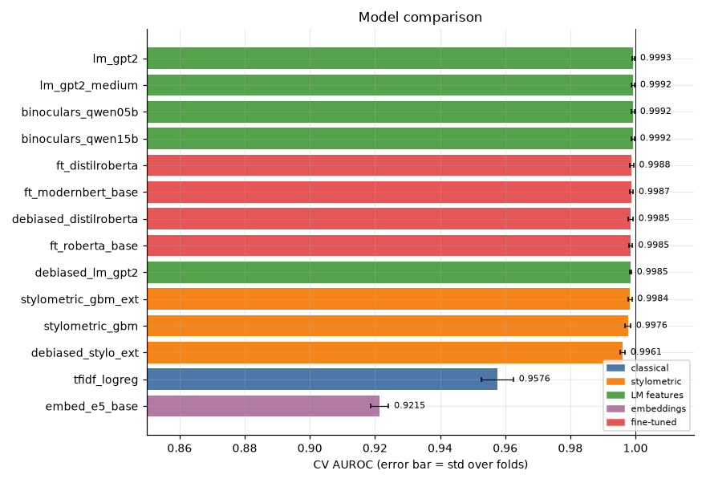
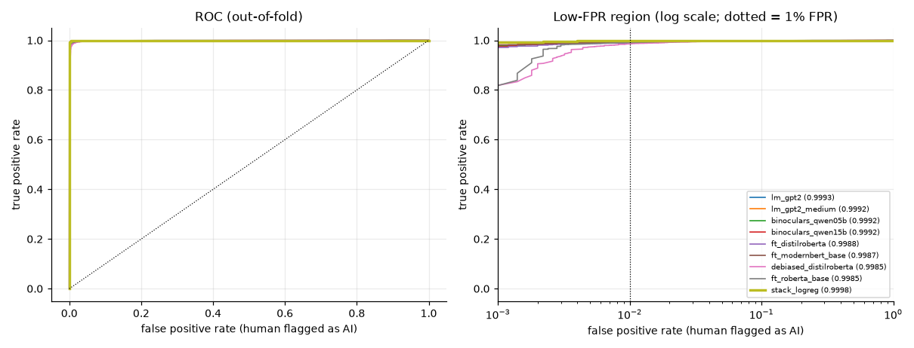
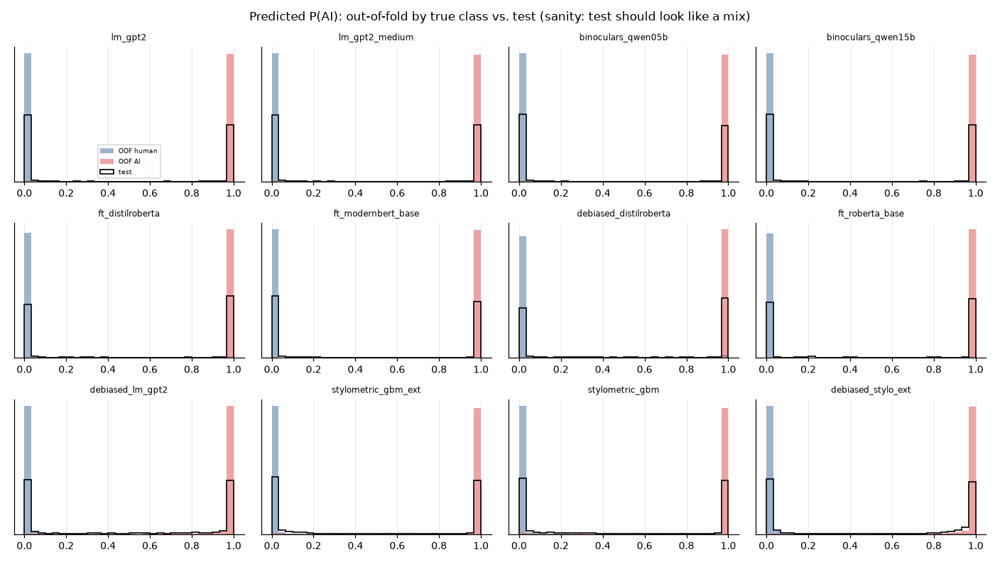
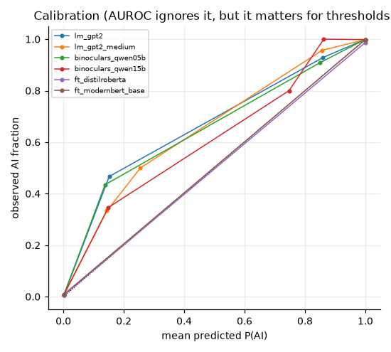
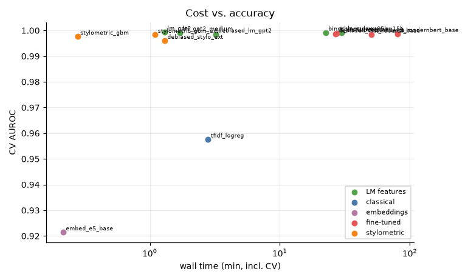
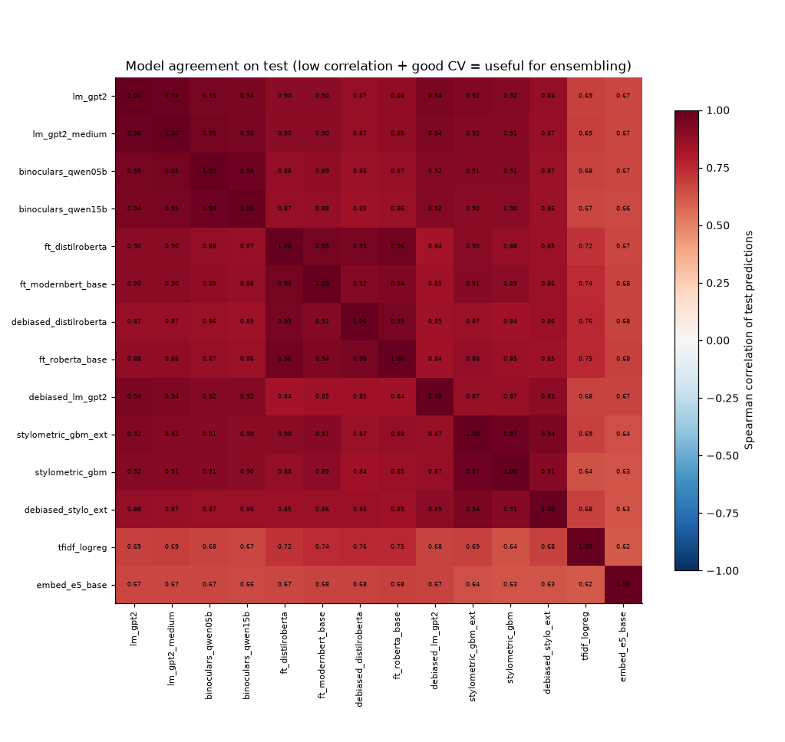
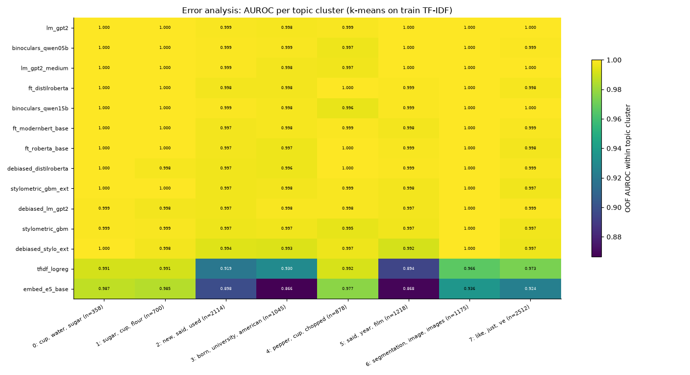

# Session `20261030-135404_ood`

Profile **ood** — Strongest models + debiased variants, scored on held-out generators and creative writing (data/eval).

Jobs: 14 ok, 0 failed, 4 not run.  Sanity checks: 4 FAIL, 0 WARN (details below).

## Recommended submission

**stack_logreg** — OOF AUROC 0.9998 on 10000 rows → `outputs/submissions/20261030-135404_ood__best.csv`

_Greedy and stacking scores are cross-validated (nested), so they are comparable to single models. Remember the test set contains unseen domains/generators — prefer robust gains over tiny CV gains._

## Results

| job | family | group | cv_scheme | n_folds | cv_auroc | fold_std | eval:eval_creative | eval:eval_newgen | tpr@1%fpr | accuracy | log_loss | time_min | device | test_mean |
|---|---|---|---|---|---|---|---|---|---|---|---|---|---|---|
| lm_gpt2 | LM features | main | stratified | 5 | 0.9993 | 0.0004 | 0.9701 |  | 0.9936 | 0.9921 | 0.0268 | 1.3 | NVIDIA GeForce RTX 3060 | 0.460 |
| lm_gpt2_medium | LM features | main | stratified | 5 | 0.9992 | 0.0005 | 0.9695 |  | 0.9932 | 0.9914 | 0.0274 | 1.7 | NVIDIA GeForce RTX 3060 | 0.461 |
| binoculars_qwen05b | LM features | main | stratified | 5 | 0.9992 | 0.0005 | 0.9672 |  | 0.9936 | 0.9930 | 0.0274 | 22.5 | NVIDIA GeForce RTX 3060 | 0.454 |
| binoculars_qwen15b | LM features | main | stratified | 5 | 0.9992 | 0.0005 | 0.9667 |  | 0.9930 | 0.9921 | 0.0284 | 29.7 | NVIDIA GeForce RTX 3060 | 0.453 |
| ft_distilroberta | fine-tuned | main | stratified | 5 | 0.9988 | 0.0006 | 0.9371 |  | 0.9906 | 0.9861 | 0.0569 | 27.4 | NVIDIA GeForce RTX 3060 | 0.529 |
| ft_modernbert_base | fine-tuned | main | stratified | 5 | 0.9987 | 0.0006 | 0.9382 |  | 0.9924 | 0.9928 | 0.0357 | 79.9 | NVIDIA GeForce RTX 3060 | 0.470 |
| debiased_distilroberta | fine-tuned | robustness | stratified | 5 | 0.9985 | 0.0007 | 0.7686 |  | 0.9860 | 0.9795 | 0.0983 | 26.9 | NVIDIA GeForce RTX 3060 | 0.535 |
| ft_roberta_base | fine-tuned | main | stratified | 5 | 0.9985 | 0.0006 | 0.9250 |  | 0.9906 | 0.9859 | 0.0662 | 50.7 | NVIDIA GeForce RTX 3060 | 0.509 |
| debiased_lm_gpt2 | LM features | robustness | stratified | 5 | 0.9985 | 0.0002 | 0.9137 |  | 0.9792 | 0.9844 | 0.0460 | 3.2 | NVIDIA GeForce RTX 3060 | 0.506 |
| stylometric_gbm_ext | stylometric | main | stratified | 5 | 0.9984 | 0.0005 | 0.9425 |  | 0.9812 | 0.9853 | 0.0472 | 1.1 | cpu | 0.458 |
| stylometric_gbm | stylometric | main | stratified | 5 | 0.9976 | 0.0009 | 0.9501 |  | 0.9740 | 0.9821 | 0.0539 | 0.5 | cpu | 0.473 |
| debiased_stylo_ext | stylometric | robustness | stratified | 5 | 0.9961 | 0.0007 | 0.7505 |  | 0.9422 | 0.9747 | 0.0747 | 1.3 | cpu | 0.522 |
| tfidf_logreg | classical | main | stratified | 5 | 0.9576 | 0.0049 | 0.7187 |  | 0.7170 | 0.8944 | 0.2824 | 2.8 | cpu | 0.441 |
| embed_e5_base | embeddings | main | stratified | 5 | 0.9215 | 0.0027 | 0.8362 |  | 0.4092 | 0.8486 | 0.3817 | 0.4 | NVIDIA GeForce RTX 3060 | 0.511 |

### Jobs that did not finish

| job | config | status | error |
|---|---|---|---|
| ft_deberta_v3_base | ft_deberta_v3_base | skipped |  |
| ft_deberta_v3_large | ft_deberta_v3_large | skipped |  |
| ft_openai_detector_large | ft_openai_detector_large | skipped |  |
| debiased_deberta_v3_base | ft_deberta_v3_base | skipped |  |

Full logs: `outputs/sessions/20261030-135404_ood/logs/<job>.log`

## Ensembles

| method | auroc | tpr@1%fpr | rows_evaluated | members |
|---|---|---|---|---|
| stack_logreg | 0.9998 | 0.9982 | 10000 | lm_gpt2:+0.08 + lm_gpt2_medium:+0.29 + binoculars_qwen05b:+0.27 + binoculars_qwen15b:+0.02 + ft_distilroberta:+0.15 + ft_modernbert_base:+0.12 + ft_roberta_base:+0.16 + stylometric_gbm_ext:+0.28 + stylometric_gbm:-0.45 + tfidf_logreg:+0.20 + embed_e5_base:-0.17 |
| greedy_selection | 0.9996 | 0.9964 | 10000 | lm_gpt2:0.43 + ft_distilroberta:0.17 + binoculars_qwen05b:0.10 + ft_modernbert_base:0.10 + ft_roberta_base:0.10 + stylometric_gbm_ext:0.07 + binoculars_qwen15b:0.03 |
| rank_mean_top5 | 0.9996 | 0.9966 | 10000 | lm_gpt2 + lm_gpt2_medium + binoculars_qwen05b + binoculars_qwen15b + ft_distilroberta |
| rank_mean_all | 0.9995 | 0.9938 | 10000 | 11 models |
| single_best (lm_gpt2) | 0.9993 | 0.9936 | 10000 | lm_gpt2 |

## Robustness / generalisation runs

| job | config | cv_scheme | train_frac | cv_auroc | baseline_cv_auroc | delta |
|---|---|---|---|---|---|---|
| debiased_stylo_ext | stylometric_gbm_ext | stratified | 1.0000 | 0.9961 | 0.9984 | -0.0023 |
| debiased_lm_gpt2 | lm_gpt2 | stratified | 1.0000 | 0.9985 | 0.9993 | -0.0008 |
| debiased_distilroberta | ft_distilroberta | stratified | 1.0000 | 0.9985 | 0.9988 | -0.0003 |

## Figures

### Model comparison

### ROC curves

### Score distributions

### Calibration

### Cost vs accuracy

### Model agreement

### Per-topic AUROC

## Sanity checks

4 FAIL, 0 WARN, 128 PASS.

| scope | check | result | detail |
|---|---|---|---|
| ft_deberta_v3_base | job finished | FAIL | skipped |
| ft_deberta_v3_large | job finished | FAIL | skipped |
| ft_openai_detector_large | job finished | FAIL | skipped |
| debiased_deberta_v3_base | job finished | FAIL | skipped |

Full list: `sanity.csv`. Summary of every job and metric: `summary.csv`.
