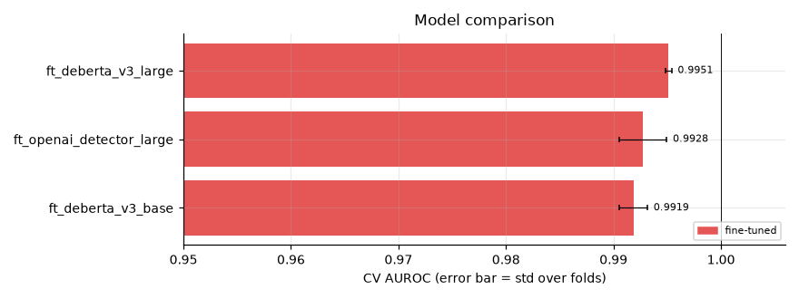
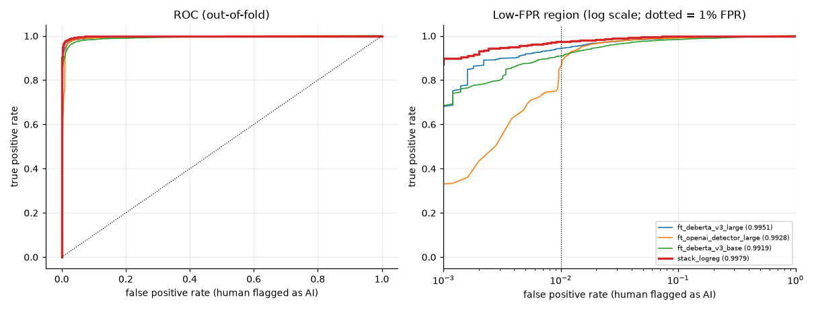
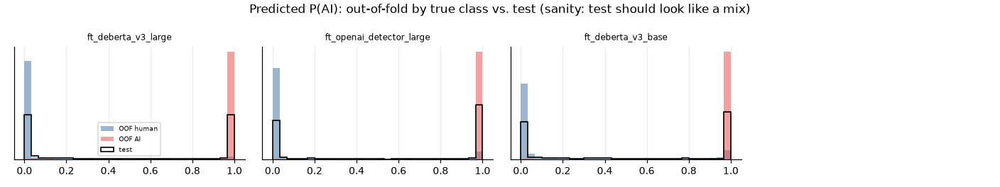
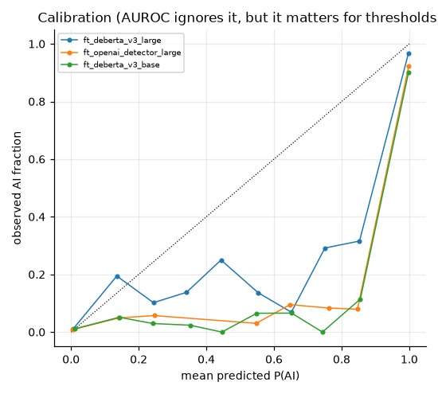
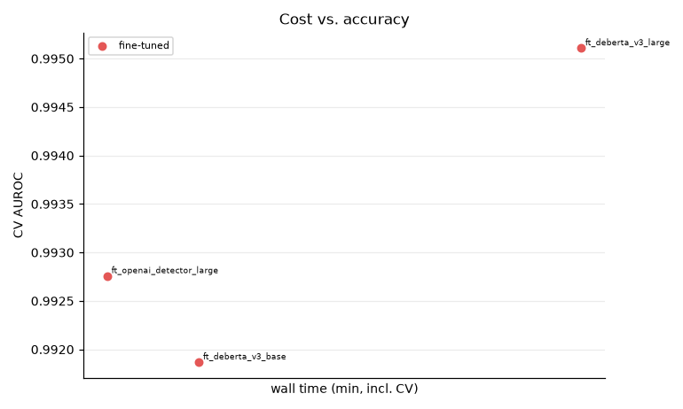
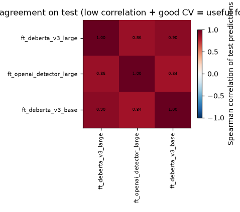
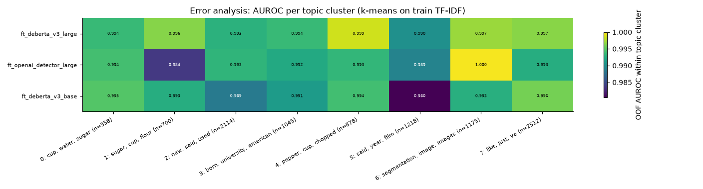

# Session `20261031-144451_ood`

Profile **ood** — Strongest models + debiased variants, scored on held-out generators and creative writing (data/eval).

Jobs: 3 ok, 0 failed, 0 not run.  Sanity checks: 0 FAIL, 1 WARN (details below).

## Recommended submission

**stack_logreg** — OOF AUROC 0.9979 on 10000 rows → `outputs/submissions/20261031-144451_ood__best.csv`

_Greedy and stacking scores are cross-validated (nested), so they are comparable to single models. Remember the test set contains unseen domains/generators — prefer robust gains over tiny CV gains._

## Results

| job | family | group | cv_scheme | n_folds | cv_auroc | fold_std | eval:eval_creative | eval:eval_newgen | tpr@1%fpr | accuracy | log_loss | time_min | device | test_mean |
|---|---|---|---|---|---|---|---|---|---|---|---|---|---|---|
| ft_deberta_v3_large | fine-tuned | main | stratified | 5 | 0.9951 | 0.0003 | 0.8316 |  | 0.9434 | 0.9661 | 0.1211 | 88.3 | NVIDIA GeForce RTX 5070 | 0.480 |
| ft_openai_detector_large | fine-tuned | main | stratified | 5 | 0.9928 | 0.0022 | 0.9033 |  | 0.8468 | 0.9408 | 0.2751 | 51.1 | NVIDIA GeForce RTX 5070 | 0.560 |
| ft_deberta_v3_base | fine-tuned | main | stratified | 5 | 0.9919 | 0.0013 | 0.8329 |  | 0.9084 | 0.9147 | 0.3538 | 56.8 | NVIDIA GeForce RTX 5070 | 0.531 |

## Ensembles

| method | auroc | tpr@1%fpr | rows_evaluated | members |
|---|---|---|---|---|
| stack_logreg | 0.9979 | 0.9736 | 10000 | ft_deberta_v3_large:+0.49 + ft_openai_detector_large:+0.38 + ft_deberta_v3_base:+0.05 |
| greedy_selection | 0.9978 | 0.9834 | 10000 | ft_deberta_v3_large:0.43 + ft_openai_detector_large:0.40 + ft_deberta_v3_base:0.17 |
| rank_mean_top5 | 0.9977 | 0.9820 | 10000 | ft_deberta_v3_large + ft_openai_detector_large + ft_deberta_v3_base |
| rank_mean_all | 0.9977 | 0.9820 | 10000 | 3 models |
| single_best (ft_deberta_v3_large) | 0.9951 | 0.9434 | 10000 | ft_deberta_v3_large |

## Figures

### Model comparison

### ROC curves

### Score distributions

### Calibration

### Cost vs accuracy

### Model agreement

### Per-topic AUROC

## Sanity checks

0 FAIL, 1 WARN, 28 PASS.

| scope | check | result | detail |
|---|---|---|---|
| ft_openai_detector_large | test score distribution close to OOF distribution (KS < 0.25) | WARN | KS 0.252 - large values mean distribution shift or a preprocessing mismatch |

Full list: `sanity.csv`. Summary of every job and metric: `summary.csv`.
