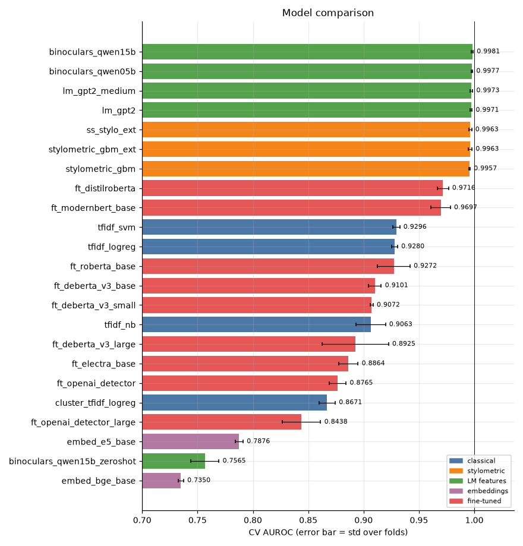
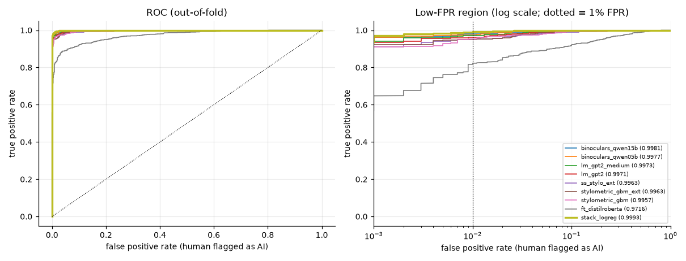
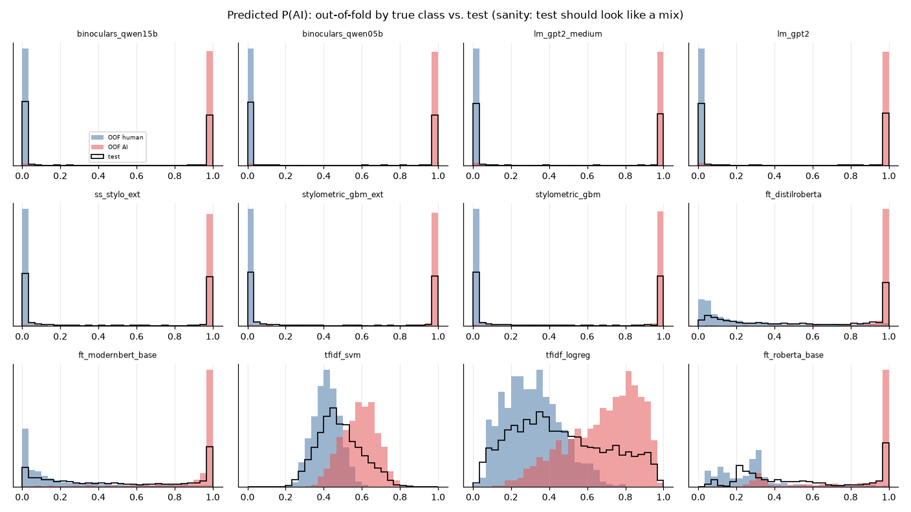
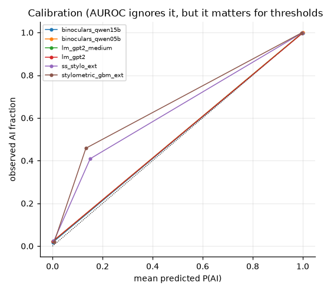
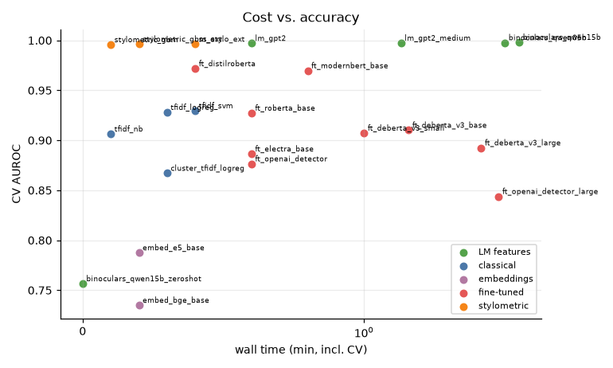
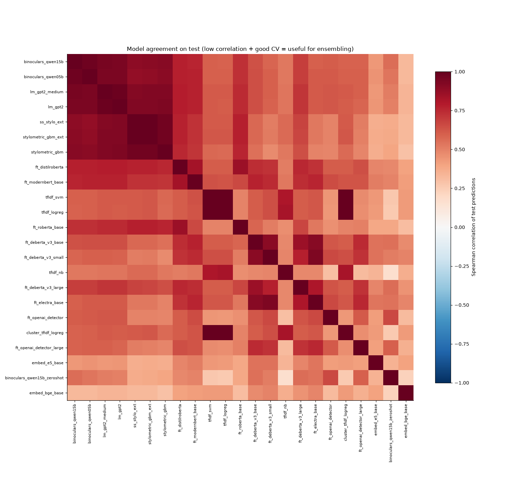
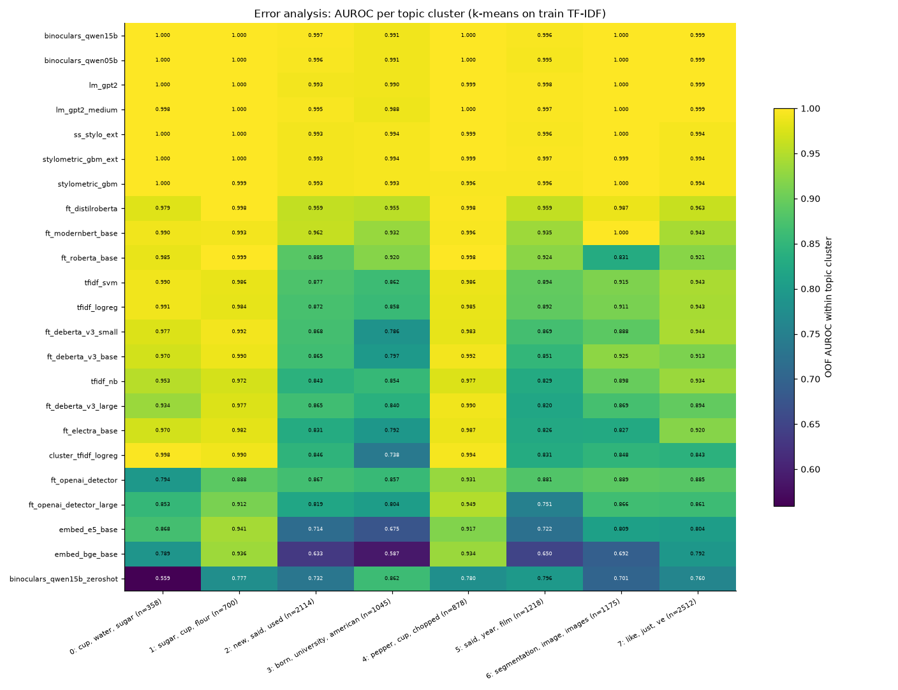

# Session `20261028-142803_smoke`

Profile **smoke** — Every config on a tiny budget to catch setup errors before the real run.

Jobs: 23 ok, 0 failed, 0 not run.  Sanity checks: 0 FAIL, 2 WARN (details below).

## Recommended submission

**stack_logreg** — OOF AUROC 0.9993 on 2000 rows → `outputs/submissions/20261028-142803_smoke__best.csv`

_Greedy and stacking scores are cross-validated (nested), so they are comparable to single models. Remember the test set contains unseen domains/generators — prefer robust gains over tiny CV gains._

## Results

| job | family | group | cv_scheme | n_folds | cv_auroc | fold_std | tpr@1%fpr | accuracy | log_loss | time_min | device | test_mean |
|---|---|---|---|---|---|---|---|---|---|---|---|---|
| binoculars_qwen15b | LM features | main | stratified | 2 | 0.9981 | 0.0008 | 0.9810 | 0.9830 | 0.0672 | 4.1 | NVIDIA GeForce RTX 5070 | 0.441 |
| binoculars_qwen05b | LM features | main | stratified | 2 | 0.9977 | 0.0007 | 0.9750 | 0.9830 | 0.0730 | 3.6 | NVIDIA GeForce RTX 3060 | 0.443 |
| lm_gpt2_medium | LM features | main | stratified | 2 | 0.9973 | 0.0011 | 0.9710 | 0.9805 | 0.0823 | 1.4 | NVIDIA GeForce RTX 3060 | 0.453 |
| lm_gpt2 | LM features | main | stratified | 2 | 0.9971 | 0.0008 | 0.9610 | 0.9740 | 0.0867 | 0.6 | NVIDIA GeForce RTX 5070 | 0.459 |
| ss_stylo_ext | stylometric | semi_supervised | stratified | 2 | 0.9963 | 0.0013 | 0.9530 | 0.9710 | 0.0848 | 0.4 | cpu | 0.467 |
| stylometric_gbm_ext | stylometric | main | stratified | 2 | 0.9963 | 0.0016 | 0.9510 | 0.9705 | 0.0811 | 0.2 | cpu | 0.462 |
| stylometric_gbm | stylometric | main | stratified | 2 | 0.9957 | 0.0005 | 0.9540 | 0.9715 | 0.0827 | 0.1 | cpu | 0.465 |
| ft_distilroberta | fine-tuned | main | stratified | 2 | 0.9716 | 0.0050 | 0.8230 | 0.8740 | 0.2910 | 0.4 | NVIDIA GeForce RTX 5070 | 0.562 |
| ft_modernbert_base | fine-tuned | main | stratified | 2 | 0.9697 | 0.0087 | 0.7700 | 0.8885 | 0.2404 | 0.8 | NVIDIA GeForce RTX 5070 | 0.506 |
| tfidf_svm | classical | main | stratified | 2 | 0.9296 | 0.0030 | 0.5940 | 0.8510 | 0.5449 | 0.4 | cpu | 0.482 |
| tfidf_logreg | classical | main | stratified | 2 | 0.9280 | 0.0027 | 0.6140 | 0.8520 | 0.4129 | 0.3 | cpu | 0.461 |
| ft_roberta_base | fine-tuned | main | stratified | 2 | 0.9272 | 0.0147 | 0.6460 | 0.8580 | 0.3406 | 0.6 | NVIDIA GeForce RTX 5070 | 0.539 |
| ft_deberta_v3_base | fine-tuned | main | stratified | 2 | 0.9101 | 0.0058 | 0.4440 | 0.7385 | 0.5048 | 1.5 | NVIDIA GeForce RTX 3060 | 0.608 |
| ft_deberta_v3_small | fine-tuned | main | stratified | 2 | 0.9072 | 0.0013 | 0.3320 | 0.8000 | 0.4425 | 1.0 | NVIDIA GeForce RTX 3060 | 0.478 |
| tfidf_nb | classical | main | stratified | 2 | 0.9063 | 0.0134 | 0.4430 | 0.8315 | 0.5498 | 0.1 | cpu | 0.476 |
| ft_deberta_v3_large | fine-tuned | main | stratified | 2 | 0.8925 | 0.0300 | 0.3300 | 0.8350 | 0.4529 | 2.9 | NVIDIA GeForce RTX 5070 | 0.553 |
| ft_electra_base | fine-tuned | main | stratified | 2 | 0.8864 | 0.0085 | 0.2800 | 0.7445 | 0.5092 | 0.6 | NVIDIA GeForce RTX 5070 | 0.598 |
| ft_openai_detector | fine-tuned | main | stratified | 2 | 0.8765 | 0.0077 | 0.4990 | 0.7860 | 0.6057 | 0.6 | NVIDIA GeForce RTX 5070 | 0.557 |
| cluster_tfidf_logreg | classical | robustness | cluster | 2 | 0.8671 | 0.0073 | 0.4080 | 0.7405 | 0.5026 | 0.3 | cpu | 0.461 |
| ft_openai_detector_large | fine-tuned | main | stratified | 2 | 0.8438 | 0.0173 | 0.1310 | 0.7170 | 0.7806 | 3.4 | NVIDIA GeForce RTX 3060 | 0.643 |
| embed_e5_base | embeddings | main | stratified | 2 | 0.7876 | 0.0036 | 0.1360 | 0.7185 | 1.3177 | 0.2 | NVIDIA GeForce RTX 5070 | 0.439 |
| binoculars_qwen15b_zeroshot | LM features | main | stratified | 2 | 0.7565 | 0.0128 | 0.4540 | 0.7230 | 0.6175 | 0.0 | NVIDIA GeForce RTX 5070 | 0.516 |
| embed_bge_base | embeddings | main | stratified | 2 | 0.7350 | 0.0024 | 0.0980 | 0.6745 | 1.5598 | 0.2 | NVIDIA GeForce RTX 5070 | 0.477 |

## Ensembles

| method | auroc | tpr@1%fpr | rows_evaluated | members |
|---|---|---|---|---|
| stack_logreg | 0.9993 | 0.9910 | 2000 | binoculars_qwen15b:+0.25 + binoculars_qwen05b:+0.12 + lm_gpt2_medium:-0.03 + lm_gpt2:+0.12 + stylometric_gbm_ext:+0.26 + stylometric_gbm:+0.07 + ft_distilroberta:+0.74 + ft_modernbert_base:+0.16 + tfidf_svm:+0.12 + tfidf_logreg:+0.17 + ft_roberta_base:-0.10 + ft_deberta_v3_base:-0.47 + ft_deberta_v3_small:+0.94 + tfidf_nb:+0.54 + ft_deberta_v3_large:+0.07 + ft_electra_base:-0.94 + ft_openai_detector:+0.30 + ft_openai_detector_large:-0.16 + embed_e5_base:+0.09 + binoculars_qwen15b_zeroshot:-0.13 + embed_bge_base:+0.09 |
| greedy_selection | 0.9989 | 0.9890 | 2000 | stylometric_gbm_ext:0.30 + binoculars_qwen15b:0.20 + ft_distilroberta:0.13 + ft_openai_detector:0.10 + stylometric_gbm:0.07 + lm_gpt2_medium:0.03 + ft_modernbert_base:0.03 + tfidf_nb:0.03 + embed_bge_base:0.03 + binoculars_qwen05b:0.03 + tfidf_svm:0.03 |
| rank_mean_top5 | 0.9983 | 0.9820 | 2000 | binoculars_qwen15b + binoculars_qwen05b + lm_gpt2_medium + lm_gpt2 + stylometric_gbm_ext |
| single_best (binoculars_qwen15b) | 0.9981 | 0.9810 | 2000 | binoculars_qwen15b |
| rank_mean_all | 0.9959 | 0.9380 | 2000 | 21 models |

## Semi-supervised runs

| job | config | cv_scheme | train_frac | cv_auroc | baseline_cv_auroc | delta |
|---|---|---|---|---|---|---|
| ss_stylo_ext | stylometric_gbm_ext | stratified | 1.0000 | 0.9963 | 0.9963 | 0.0000 |

## Robustness / generalisation runs

| job | config | cv_scheme | train_frac | cv_auroc | baseline_cv_auroc | delta |
|---|---|---|---|---|---|---|
| cluster_tfidf_logreg | tfidf_logreg | cluster | 1.0000 | 0.8671 | 0.9280 | -0.0609 |

## Figures

### Model comparison

### ROC curves

### Score distributions

### Calibration

### Cost vs accuracy

### Model agreement

### Per-topic AUROC

## Sanity checks

0 FAIL, 2 WARN, 207 PASS.

| scope | check | result | detail |
|---|---|---|---|
| embed_bge_base | CV AUROC > 0.75 (model learned something) | WARN | 0.7350 |
| ft_deberta_v3_large | fold AUROC spread small (std < 0.03) | WARN | std 0.0300 |

Full list: `sanity.csv`. Summary of every job and metric: `summary.csv`.
