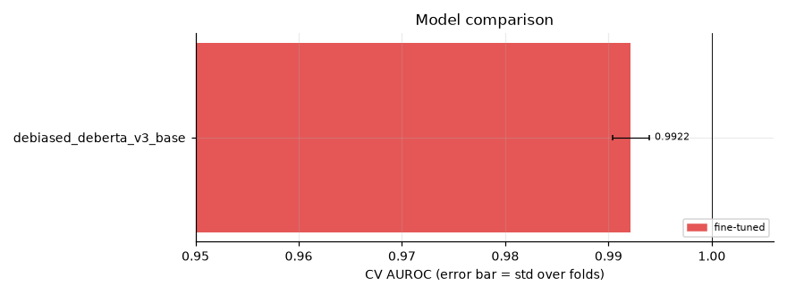
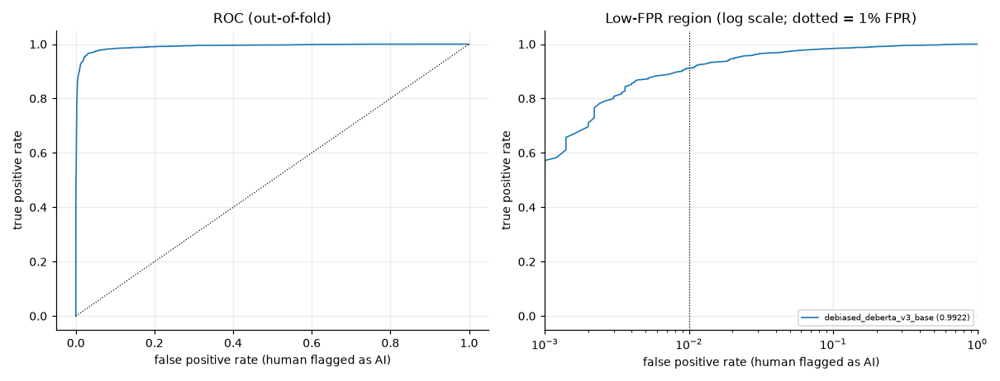
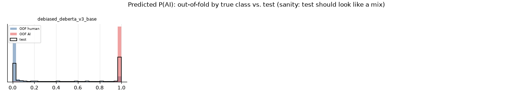
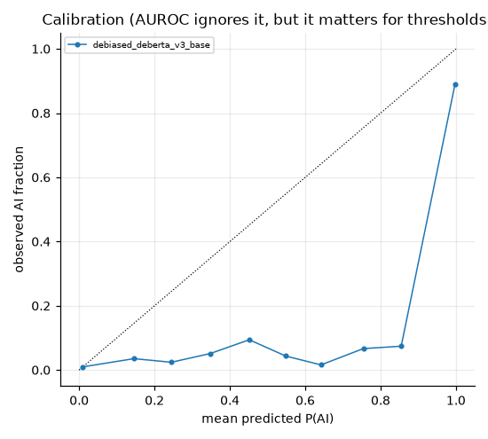
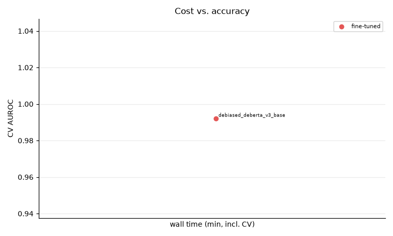
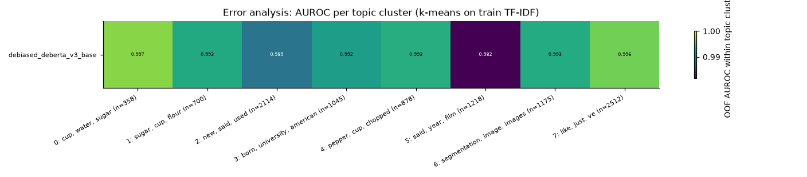

# Session `20261031-180142_ood`

Profile **ood** — Strongest models + debiased variants, scored on held-out generators and creative writing (data/eval).

Jobs: 1 ok, 0 failed, 0 not run.  Sanity checks: 0 FAIL, 0 WARN (details below).

## Results

| job | family | group | cv_scheme | n_folds | cv_auroc | fold_std | eval:eval_creative | eval:eval_newgen | tpr@1%fpr | accuracy | log_loss | time_min | device | test_mean |
|---|---|---|---|---|---|---|---|---|---|---|---|---|---|---|
| debiased_deberta_v3_base | fine-tuned | robustness | stratified | 5 | 0.9922 | 0.0017 | 0.8457 |  | 0.9104 | 0.9079 | 0.3894 | 56.6 | NVIDIA GeForce RTX 5070 | 0.541 |

## Robustness / generalisation runs

| job | config | cv_scheme | train_frac | cv_auroc | baseline_cv_auroc | delta |
|---|---|---|---|---|---|---|
| debiased_deberta_v3_base | ft_deberta_v3_base | stratified | 1.0000 | 0.9922 |  |  |

## Figures

### Model comparison

### ROC curves

### Score distributions

### Calibration

### Cost vs accuracy

### Per-topic AUROC

## Sanity checks

0 FAIL, 0 WARN, 11 PASS.

All checks passed.

Full list: `sanity.csv`. Summary of every job and metric: `summary.csv`.
